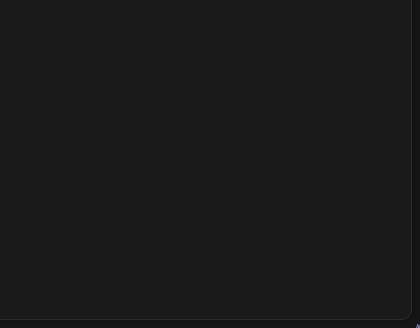
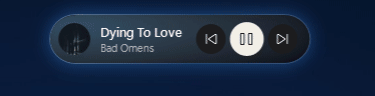

<p align="center">
  
</p>

<h1 align="center">SpotiPop</h1>

<p align="center">
  <strong>A tiny, native Windows pop-up and mini player for Spotify and Spotifast.</strong><br>
  Album art, song, artist, skip buttons and volume — native WPF, tiny footprint, no Electron, no web view.
</p>

<p align="center">
  
  
  
  
</p>

---

## Preview

<!-- Drop your recordings in docs/ with these names, or change the paths below. -->

<p align="center">
  
  <br><sub><b>Song-change pop-up</b> — slides in, glows in the colour of the album art, goes away on its own.</sub>
</p>

<p align="center">
  
  <br><sub><b>Always-on mini player</b> — thin pill that springs open when your mouse comes near.</sub>
</p>

## Features

- **Pop-up on every song change** — a translucent glass card with the album art, title, artist, previous / play-pause / next and a volume slider. It glows in the dominant colour of the cover and fades out by itself.
- **Always-on mini player** (optional) — a thin pill showing just art, title and artist. Its width adapts to the song name, so short titles leave no dead space.
  - Put it at the **top or bottom** of any monitor.
  - Controls sit **below** the song or at the **side**.
  - Show them **when the mouse is near** (spring animation, a bit like the iPhone's dynamic island) or **always**.
  - Scroll over the pill to change the volume.
- **Works with Spotify and [Spotifast](https://spotifast.rocks/)** — and follows whichever one is currently playing.
- **Stays out of your way** — it hides itself while a game, video or presentation is fullscreen (including borderless-window games), and never steals focus.
- **Light on resources** — event-driven (no constant polling when idle), GPU-rendered, trims its own memory. Around 15–20 MB resident and ~0% CPU when idle on my machine.
- **Native** — C# / WPF on .NET 9. No Electron, no browser engine, no account login, no API keys.

## Requirements

- Windows 10 (build 19041 / 2004) or Windows 11
- Spotify (desktop or Microsoft Store version) and/or Spotifast
- [.NET 9 Desktop Runtime](https://dotnet.microsoft.com/download/dotnet/9.0) to run the framework-dependent build (not needed for the self-contained build, see below)

## Build

You need the [.NET 9 SDK](https://dotnet.microsoft.com/download/dotnet/9.0) on Windows.

```powershell
git clone https://github.com/<your-user>/SpotiPop.git
cd SpotiPop

# run it straight from source
dotnet run -c Release

# or just build
dotnet build -c Release
# -> bin\Release\net9.0-windows10.0.19041.0\SpotiPop.exe
```

## Publish

Single-file exe, about 26 MB (needs the .NET 9 Desktop Runtime installed):

```powershell
dotnet publish -c Release -r win-x64 --self-contained false -p:PublishSingleFile=true -o publish
```

Fully standalone exe, about 180 MB (runs on a PC without .NET):

```powershell
dotnet publish -c Release -r win-x64 --self-contained true -p:PublishSingleFile=true -p:IncludeNativeLibrariesForSelfExtract=true -o publish
```

For ARM64 Windows, replace `win-x64` with `win-arm64`. The result is `publish\SpotiPop.exe`; put it anywhere you like and run it.

## Usage

1. Run `SpotiPop.exe`. It lives in the **system tray** (green play icon) — no window opens.
2. Play something in Spotify or Spotifast; the pop-up appears on every song change.
3. **Left-click** the tray icon to show the current song on demand, **right-click** for the menu:
   - **Settings…** — pop-up on/off, always-on mini player, its position, screen, controls placement and visibility.
   - **Start with Windows** — adds or removes the app from your startup apps.
   - **Quit**

Settings are stored in `%APPDATA%\SpotiPop\settings.json`.

## How it works

- **Now playing + buttons** come from the Windows media transport controls (the same source as the system volume flyout), so there is no Spotify login and no API key.
- **Volume** is handled per player:
  - *Spotifast* has its own volume, separate from Windows, and exposes it through its command line (`spotifast volume N`, `spotifast now-playing --raw`). SpotiPop uses that, so the slider moves the real in-app volume.
  - *Spotify* has no local volume API, so SpotiPop sets Spotify's volume in the **Windows volume mixer** (per-app volume). This only works once Spotify has produced audio at least once.
- **Fullscreen detection** uses `SHQueryUserNotificationState` plus a "captionless window covering its whole monitor" check on the foreground window.
- **Album colour** is picked from a 16×16 downscale of the cover, weighted by saturation and brightness.

## Known limitations

- Spotify's own in-app volume slider is not controllable from outside; SpotiPop changes the Windows mixer level instead (Spotifast is fully supported).
- The mini player is placed in physical pixels using the system DPI, so on setups mixing different display scaling its size on the secondary monitor can be slightly off.
- Windows can't draw ClearType text or real background blur on see-through layered windows, so the glass look is a tint rather than a frosted blur.

## Project layout

| File | What it does |
|---|---|
| `SpotifyWatcher.cs` | Follows Spotify / Spotifast through the Windows media controls, loads the cover |
| `PopupWindow.*` | Song-change card |
| `IslandWindow.*` | Always-on mini player and its spring animations |
| `SettingsWindow.*`, `Settings.cs` | Settings UI and JSON persistence |
| `PlayerVolume.cs`, `SpotifyVolume.cs`, `SpotifastCli.cs` | Volume for Spotify (mixer) and Spotifast (CLI) |
| `Fullscreen.cs`, `MemoryTrim.cs`, `WindowTricks.cs` | Fullscreen detection, memory trimming, overlay window helpers |
| `AccentColor.cs` | Dominant colour from album art |

## Legal

This project was **vibe coded** with an AI assistant. It has not been audited, it comes with **no warranty of any kind**, and you use it entirely at your own risk.

It is released into the **public domain** under [The Unlicense](LICENSE): copy it, change it, sell it, ship it, put your name on it — do whatever you want, no attribution needed. If a jurisdiction doesn't allow that, consider it licensed under the most permissive terms it does allow.

Bundled third-party pieces (the Roboto font, NAudio, .NET) keep their own licenses, listed in [NOTICE.md](NOTICE.md).

*SpotiPop is not affiliated with, endorsed by, or sponsored by Spotify AB or Spotifast. "Spotify" is a trademark of Spotify AB.*
